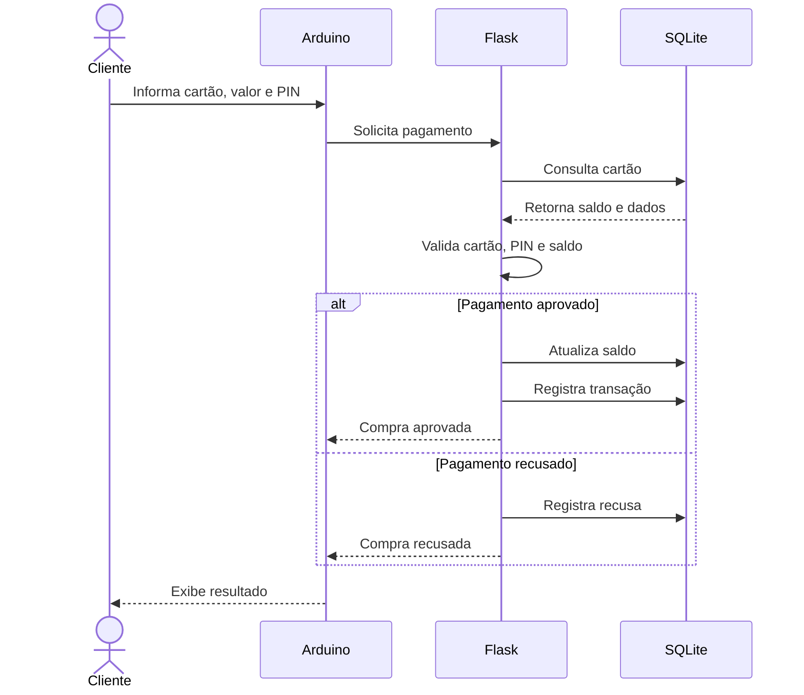

# Diagrama UML - Maquininha de Cartão

## Diagrama de Sequência

Este diagrama representa a comunicação entre o cliente,
o Arduino, o servidor Flask e o banco de dados SQLite
durante o processamento de uma compra.

